<!-- Falling ID card (animated SVG) -->

 

---

## ⚡ Tech Stack

---

## 🚀 Selected Work

| Project | What it is |
|---|---|
| [**AURA**](https://github.com/aayushtyagi00/AURA) | Social media platform concept in React with live Claude API calls |
| [**ExpertEdge**](https://github.com/aayushtyagi00/ExpertEdge) | React Native marketplace for paid consultations with retired professionals |
| [**MEMORY AI**](https://github.com/aayushtyagi00/MEMORY-AI) | Searchable personal memory app on Supabase + Gemini File Search |
| [**LaptopIQ**](https://github.com/aayushtyagi00/LaptopIQ) | Laptop discovery and recommendation platform |
| [**MindCraft AI**](https://github.com/aayushtyagi00/MindCraft-AI) | Gemini-powered study tool generator |
| [**Stock Council AI**](https://github.com/aayushtyagi00/Stock-Council-AI) | Multi-agent investment analysis platform |
| [**VaultMind**](https://github.com/aayushtyagi00/VaultMind) | Local-first Android personal digital vault |

<!-- Swap the repo links above to your real repo names. -->

---

## 📊 GitHub Stats

 

 

### 📈 Contribution Graph

---

## 🐍 Contribution Snake

<picture>
  <source media="(prefers-color-scheme: dark)" srcset="https://raw.githubusercontent.com/aayushtyagi00/aayushtyagi00/output/github-snake-dark.svg"/>
  <source media="(prefers-color-scheme: light)" srcset="https://raw.githubusercontent.com/aayushtyagi00/aayushtyagi00/output/github-snake.svg"/>
  
</picture>

---

