<!-- Falling ID card (animated SVG) -->

 

---

## ⚡ Tech Stack

---

## 🚀 Selected Work

<!-- Project names/links live in tools/build_assets.py. Edit there, run it, commit. -->

---

## 📊 GitHub Stats

<!-- Generated by .github/workflows/stats.yml from your own repo; no third-party servers -->

 

---

## 🐍 Contribution Snake

<picture>
  <source media="(prefers-color-scheme: dark)" srcset="https://raw.githubusercontent.com/aayushtyagi00/aayushtyagi00/output/github-snake-dark.svg"/>
  <source media="(prefers-color-scheme: light)" srcset="https://raw.githubusercontent.com/aayushtyagi00/aayushtyagi00/output/github-snake.svg"/>
  
</picture>

